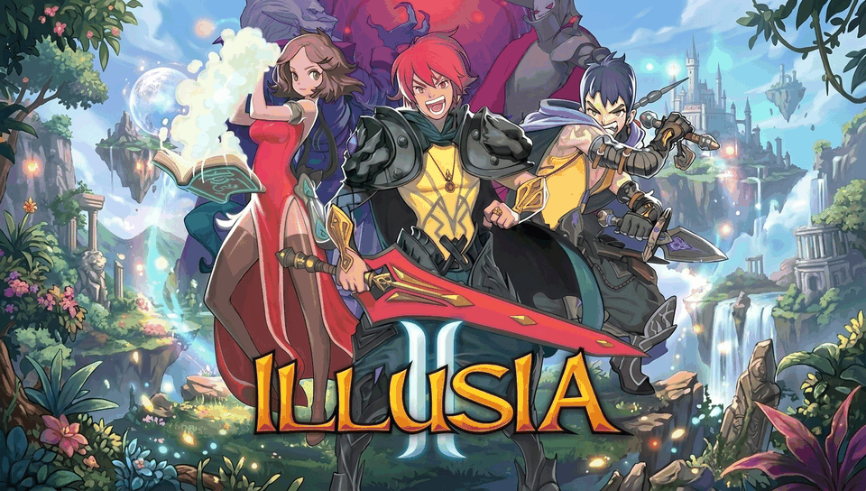

# ILLUSIA 2 for PS Vita

<p align="center">
  
</p>

<p align="center">
  
  
  
  
</p>

An ARM dynamic binary loader / native wrapper of **ILLUSIA 2** (Android v1.0.3) for the **PlayStation Vita** / **PlayStation TV** using [so-loader](https://github.com/TheOfficialFloW/so-loader) and [vitaGL](https://github.com/Rinnegatamante/vitaGL).

---

## 📌 Status & Current State

- **Current State:** Work In Progress (WIP).
- **Execution:** Engine boots and executes without crashing (crashes resolved in JNI / Dalvik ArrayObject bridges and native patches).
- **Known Issues:** 
  - Asset/scene loading is currently incomplete (resources and rendering pipeline are still being hooked and polished).
  - In-game menus and stage rendering may be partially displayed or missing textures during transitions.

---

## 🎮 Controls

| Button | Action |
| :--- | :--- |
| **D-Pad / Left Stick** | Movement / Menu Navigation |
| **Cross ($\times$)** | Jump / Confirm |
| **Square ($\square$)** | Attack / Action |
| **Circle ($\bigcirc$)** | Special Skill / Cancel |
| **Triangle ($\triangle$)** | Inventory / Menu |
| **L Trigger** | Quick Item 1 / Dash |
| **R Trigger** | Quick Item 2 / Dash |
| **Start** | Pause Menu |
| **Select** | Status / Map |
| **Touchscreen** | Native Touch / On-Screen UI interaction |

---

## 📦 Installation & Setup

1. Install the VPK using **VitaShell**.
2. Obtain a legally purchased copy of **ILLUSIA 2 (v1.0.3)** for Android (APK).
3. Open the `.apk` file using any archive manager (such as 7-Zip, WinRAR, or `unzip`).
4. Extract `lib/armeabi/libgameDSO.so` and place it in:
   ```text
   ux0:data/illusia2/libgameDSO.so
   ```
5. Extract the contents of the `assets/` folder from the APK and copy them into:
   ```text
   ux0:data/illusia2/assets/
   ```
6. Launch the game from the LiveArea.

---

## 🛠️ Building from Source

### Prerequisites

- [VitaSDK](https://vitasdk.org/) installed and configured in your environment (`$VITASDK`).
- [vitaGL](https://github.com/Rinnegatamante/vitaGL) installed in your VitaSDK sysroot.
- `libvita2d`, `libvorbisidec` (Tremor), `libpthread-embedded`, `so_util`, `fios2`.

### Compilation

```bash
mkdir build && cd build
cmake ..
make -j$(nproc)
```

This will produce `illusia2.vpk` ready for installation.

---

## ☕ Support My Work

This project is **free** and will stay free. If you enjoy it, a tip from **$1** helps me keep porting games to the PS Vita:

<p align="center">
  <a href="https://ko-fi.com/metalsyntax"></a>
</p>

- **Ko-fi:** [ko-fi.com/metalsyntax](https://ko-fi.com/metalsyntax)
- **PayPal:** [paypal.me/MetalSyntax](https://paypal.me/MetalSyntax)
- **Bitcoin (BTC):** `133HdCsaWxdjTfmwpgGVykByhNBV338uRc`

**Ko-fi supporters get:**
- **Early access** to new ports before their public release (test builds of upcoming projects).
- **Data preparation scripts and step-by-step guides** to set up your own game files for each new port.
- A say in which games I port next.

> Game files are never distributed. You always need your own legally obtained copy of the game.

---

## 👥 Credits & Acknowledgments

- **Gamevil** — For creating *ILLUSIA 2*.
- **TheFloW** — For the original `so-loader` concept, dynamic linker implementation, and libc bridge.
- **Rinnegatamante** — For [vitaGL](https://github.com/Rinnegatamante/vitaGL) and invaluable contributions to the PS Vita homebrew ecosystem.
- **vitasdk developers** — For maintaining the homebrew toolchain.

---

## ⚖️ Disclaimer

This repository does **not** contain any proprietary assets, game code, audio, or binaries owned by Gamevil. Users must supply their own legally acquired `libgameDSO.so` and game asset files from the original Android release.
